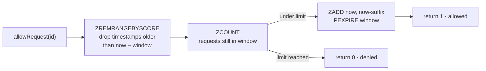

# rate-limiter

A distributed rate limiter for Node.js. Every app instance shares one Redis. Each decision is a single Lua script, so concurrent requests from different instances can't race between reading the count and recording the request.

**Algorithm:** sliding-window log &nbsp;·&nbsp; **Stack:** TypeScript, ioredis, Redis, Jest

## How it works

Each client key (user id, API key, IP) is a Redis sorted set with one entry per allowed request. The score is the request's timestamp and the member is that timestamp plus a random suffix, so two requests in the same millisecond are counted as two. For every request, one Lua script runs these steps:



Redis executes a script as one command, so the trim, count and add happen atomically. Two app instances serving the same client at the same moment can't both see `limit − 1` and both let a request through. The `PEXPIRE` lets idle keys clean themselves up, at millisecond precision, so any window length works. The script is registered once with ioredis `defineCommand`, so each call sends only its SHA (`EVALSHA`) and ioredis reloads it if Redis has dropped it. Denied requests aren't recorded, so a client that keeps retrying is only held back until its oldest request ages out.

### Why a sliding log rather than a fixed window

A fixed-window counter (`INCR` + `EXPIRE`) is cheaper, but it allows up to twice the limit across a window boundary: `limit` requests at 0:59 and `limit` more at 1:00. The sliding log counts exactly the last `windowSize` milliseconds at every instant. It costs O(limit) memory per active key instead of one integer, which is fine for per-user API limits. For very high limits, a token bucket or sliding-window counter is the better trade.

## Usage

```typescript
import Redis from 'ioredis';
import RateLimiter from './RateLimiter';

const redis = new Redis(process.env.REDIS_URL);
const limiter = new RateLimiter({ limit: 5, windowSize: 60_000 }, redis); // 5 requests per minute

const allowed = await limiter.allowRequest('user-42');
```

| Option | Meaning |
|--------|---------|
| `limit` | Maximum requests allowed inside any window |
| `windowSize` | Window length in milliseconds, e.g. `1500` |

### As Express middleware

```typescript
app.use(async (req, res, next) => {
  const allowed = await limiter.allowRequest(req.ip ?? 'anonymous');
  if (!allowed) return res.status(429).json({ message: 'Too many requests' });
  next();
});
```

## Run it

```bash
docker run --rm -d -p 6379:6379 redis:7   # throwaway Redis: the tests call FLUSHALL
npm install
npm test                                  # limit, same-millisecond bursts, 1.5 s window
npm run build && npm start                # demo: 10 requests against a limit of 5
```

## Known limitations

- **Clock comes from the app.** `now` is each instance's `Date.now()`, so clock skew between instances shifts their windows by that much. Reading Redis `TIME` inside the script would give every instance one clock.

## License

MIT
